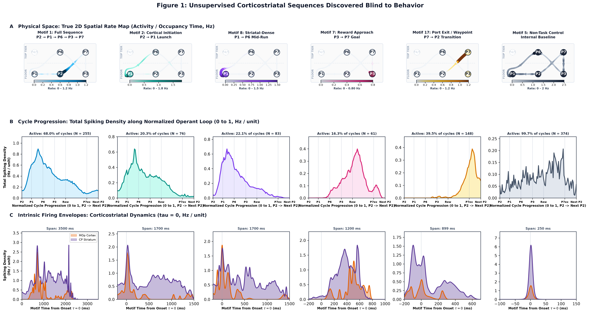
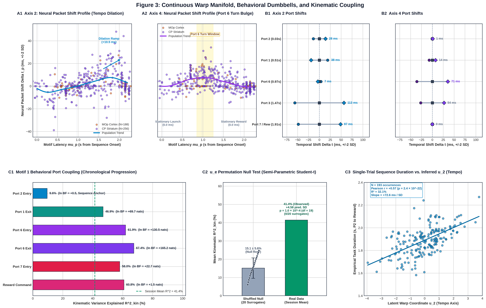

# PurePacketPPSeq.jl

**Exact, Continuous-Time Marked Point-Process Modeling for Unsupervised Neural Sequence Discovery**

[](https://opensource.org/licenses/MIT)
[](https://julialang.org)

`PurePacketPPSeq.jl` is a high-performance Julia package implementing a continuous-time marked point-process framework for discovering coordinated, multi-neuronal spatiotemporal firing motifs from large-scale extracellular recordings (e.g., Neuropixels) **without temporal binning, template matching, or external statistical readouts**.

Traditional sequence detection algorithms either discretize continuous spike trains into arbitrary time bins (destroying millisecond-scale latency jitter and warping information) or rely on external regression classifiers and neural decoders that overfit and lack generative consistency. `PurePacketPPSeq.jl` models each individual spike as an event generated from a continuous intensity function governed by latent sequence occurrences, multi-timescale background excitability, motor vigor, and heavy-tailed continuous temporal warping.

---

## 1. Generative Point-Process Formulation

Let $c \in \{1, \dots, N\}$ denote the recorded neural units, and let $\mathcal{S} = \{(t_i, c_i)\}_{i=1}^{N_{\mathrm{spikes}}}$ denote the continuous event stream over session duration $T$. The instantaneous conditional intensity function for unit $c$ at time $t$ is defined as:

$$\lambda_c(t) = \lambda_c^{(0)}(t) + \sum_{e=1}^E c_e \sum_{p \in \mathcal{P}_{z_e}: \mathrm{chan}(p)=c} a_p \, \mathcal{N}\left(t \;\middle|\; \tau_e + \mu_p + \sum_{r=1}^R W_{p,r}^{(z_e)} u_{e,r}, \; \sigma_p^2\right)$$

where:
- $\lambda_c^{(0)}(t)$ is the multi-scale, continuous-time background intensity.
- $z_e \in \{1, \dots, M\}$ is the discrete motif archetype identity of occurrence $e$.
- $\tau_e \in [0, T]$ is the continuous onset time of occurrence $e$.
- $c_e > 0$ is the single-trial motor vigor amplitude scaling factor.
- $\mathbf{u}_e \in \mathbb{R}^R$ is the latent continuous temporal warping coordinate vector.
- $\mathcal{P}_z$ is the set of Gaussian spike packets comprising motif $z$.
- $a_p, \mu_p, \sigma_p^2$ are the packet amplitude mass, mean temporal latency, and timing variance on unit $\mathrm{chan}(p)$.
- $\mathbf{W}^{(z)} \in \mathbb{R}^{|\mathcal{P}_z| \times R}$ is the learned linear kinematic warping projection for motif $z$.

The exact point-process log-likelihood over the entire recording is evaluated analytically without numerical quadrature:

$$\ln \mathcal{L}(\mathcal{S} \mid \boldsymbol{\Theta}) = \sum_{i=1}^{N_{\mathrm{spikes}}} \ln \lambda_{c_i}(t_i) - \sum_{c=1}^N \int_0^T \lambda_c(t) \, dt$$

The continuous compensator integral for any Gaussian packet on channel $c$ evaluates in closed form via the error function $\operatorname{erf}(\cdot)$:

$$\int_{T_1}^{T_2} \mathcal{N}(t \mid \tilde{\mu}, \sigma^2) \, dt = \frac{1}{2} \left[ \operatorname{erf}\left(\frac{T_2 - \tilde{\mu}}{\sqrt{2\sigma^2}}\right) - \operatorname{erf}\left(\frac{T_1 - \tilde{\mu}}{\sqrt{2\sigma^2}}\right) \right]$$

---

## 2. Model Tier Hierarchy & Conjugate Point-Process Architecture

The package is built around a compositional hierarchy of generative tiers ($m = 0 \to 5$), where each level adds an explicit biophysical mechanism with closed-form conjugate updates:

| Tier | Mathematical Mechanism | Generative Contribution | Source Module |
| :--- | :--- | :--- | :--- |
| **$m = 0$** | Multi-Scale Background Floor | Baseline firing rate $\bar{\lambda}_{0,c}$ and stationary Poisson noise | `src/scales/`, `m0_floor.jl` |
| **$m = 1$** | Biophysical Spike Packets | Localized Gaussian packet archetype $(a_p, \mu_p, \sigma_p^2)$ with $\text{SNR}_p > 1.0$ | `src/mechanisms/m1_packet.jl` |
| **$m = 2$** | Single-Trial Motor Vigor | Latent burst amplitude scaling $c_e \sim \operatorname{Gamma}(\alpha_c, \alpha_c)$ | `src/mechanisms/m2_carrier.jl` |
| **$m = 3$** | Motif Dictionary Prior | Reversible-Jump archetype birth/death with Two-Part MDL complexity tax | `src/mechanisms/m3_motif.jl` |
| **$m = 4$** | Continuous Warping Manifold | Heavy-tailed Student-$t$ kinematics $\mathbf{u}_e$ with ARD precision pruning | `src/mechanisms/m4_manifold.jl` |
| **$m = 5$** | Fully Coupled Continuous Engine | Dual-timescale OU network arousal $x_r(t)$ and cellular micro-drift $\delta x_c(t)$ | `src/mechanisms/m5_ou.jl` |

### Core Architectural Pillars

| Mechanism | Model Specification | Key Properties |
| :--- | :--- | :--- |
| **Leg 1: Multi-Scale Background Filtering** | $\ln \lambda_c^{(0)}(t) = \ln \bar{\lambda}_{0,c} + \mu_{r(c)} + x_{r(c)}(t) + \delta x_c(t)$ | **Fast network OU ($x_r, \tau_{\mathrm{net}} \approx 0.5\text{ s}$):** Absorbs sub-second waves of regional gain (e.g. MOp vs. CP, $\rho \approx +0.162$), preventing unstructured surges from forming false motifs.<br>**Slow cellular drift ($\delta x_c, \tau_{\mathrm{cell}} \approx 60\text{ s}$):** Tracks unit-specific multi-minute baseline drift across long recordings.<br>**Gauge Invariance:** Zero-mean constraints enforced via projection operators. |
| **Leg 2: Single-Trial Motor Vigor Pinning** | $c_e \sim \operatorname{Gamma}(\alpha_c, \beta_c), \quad \beta_c = \alpha_c \implies \mathbb{E}[c_e] = 1.0$ | Decouples burst intensity from internal sequence tempo. Prevents the model from creating duplicate motifs for high-rate vs. low-rate trial executions. Shape parameter $\alpha_c$ updates dynamically across MCMC sweeps. |
| **Leg 3: Heavy-Tailed Warping & ARD** | $\mathbf{u}_e \mid \eta_e \sim \mathcal{N}\left(\mathbf{0}, \; \left(\eta_e \operatorname{diag}(\boldsymbol{\alpha})\right)^{-1}\right), \quad \eta_e \sim \operatorname{Gamma}\left(\frac{\nu}{2}, \frac{\nu}{2}\right)$ | **Heavy-Tailed Robustness:** Marginal Student-$t$ prior ($\mathbf{u}_e \sim \mathcal{T}_\nu(\mathbf{0}, \boldsymbol{\alpha}^{-1}), \nu = 4.0$) prevents behavioural timing outliers from destabilizing motif archetypes.<br>**Automatic Relevance Determination (ARD):** Hyper-priors $\alpha_r \sim \operatorname{Gamma}(a_\alpha, b_\alpha)$ drive $\alpha_r \to \infty$ for uninformative axes, automatically pruning inactive warping dimensions. |

---

## 3. Reversible-Jump MCMC (RJMCMC) Engine

`PurePacketPPSeq.jl` implements trans-dimensional RJMCMC moves to infer the number of motifs $M$ and packets $P_z$ directly from the data:

1. **Motif Birth & Death:**
   - **Dimension-Matching Birth:** Proposes new motif archetypes seeded from unassigned high-density event clusters.
   - **Two-Part Minimum Description Length (MDL) Prior:** Every proposed motif must overcome a strict dictionary code-length penalty:
     $$\Delta \ln \pi(\Theta) = -\left(\lambda_{\mathrm{dict}} + k_{\mathrm{packet}} P_z + k_{\mathrm{channel}} \sum_{c} \mathbb{I}[c \in \mathcal{P}_z]\right)$$
     preventing runaway dictionary bloat and ensuring parsimonious sequence recovery.
2. **Packet Gibbs Resampling:**
   - Packet latencies $\mu_p$ and temporal variances $\sigma_p^2$ are updated conditionally via conjugate normal-inverse-gamma transitions.
   - Packet masses $a_p$ are sampled conditionally subject to a biophysical SNR threshold ($\text{SNR}_p > 1.0$).
3. **Continuous Warping M-Step:**
   - Ridge-regularized projection updates for $\mathbf{W}^{(z)}$ combined with analytical Gibbs conditional updates for latent coordinates $\mathbf{u}_e$.

---

## 4. Empirical Benchmarks & Validation Suite

The framework was benchmarked on dual-structure Neuropixels recordings from awake mice performing an operant behavioral task (motor cortex $\text{MOp}$: $N = 208$ units; dorsal striatum $\text{CP}$: $N = 203$ units; $411$ units total; $2.48\text{M}$ events across $2,114.3\text{ s}$):

### A. Unsupervised Motif Discovery & Regional Ordering

- Discovers reproducible spatiotemporal sequences across hundreds of units without behavioral supervision.
- Reveals that cortical firing systematically precedes striatal firing by $+298.6\text{ ms}$ in full operant sequences (Motif 1) and $+339.3\text{ ms}$ on average across motifs.

### B. Split-Half Out-of-Sample Cross-Validation
- Evaluated on chronologically separated out-of-sample data with frozen motif archetypes:
  $$\Delta LL_{\mathrm{CV}} = +4,556\text{ nats} \quad (+1.39\text{ nats / event})$$
- Demonstrates a **$4.0\times$ temporal concentration** above the shifted null floor ($-2,020\text{ nats}$).

### C. Continuous Kinematic Coupling

- Inferred latent warping coordinates $\mathbf{u}_e$ correlate with single-trial movement kinematics:
  $$\text{Mean } R^2_{\mathrm{kin}} = 41.4\% \quad (p = 1.0 \times 10^{-4}, \text{ predictive Student-}t)$$
- Tracks single-trial behavioral execution duration with $r = +0.57$.

### D. Leak-Free Joint vs. Independent Cross-Validation (Held-Out Data)
Models were trained cold ($M_{\mathrm{init}} = 0$) on $t \in [400, 1200\text{ s}]$ and scored on an unseen $500\text{ s}$ held-out block ($t \in [1200, 1700\text{ s}]$, $593,118$ test spikes):

$$\Delta LL_1 = LL_{\mathrm{joint}} - \left(LL_{\mathrm{MOp}} + LL_{\mathrm{CP}}\right) = \mathbf{+17,027.50\text{ nats}} \quad (\mathbf{+0.0414\text{ bits / spike}})$$

- Cortical held-out gain: $+4,877.62\text{ nats}$ ($+0.0191\text{ nats/spk}$)
- Striatal held-out gain: $+12,149.88\text{ nats}$ ($+0.0360\text{ nats/spk}$)
- Model C achieved higher test likelihood using **fewer total motifs** ($M=16$) than the two independent regional models combined ($M = 8 + 10 = 18$).

### E. Prospective Causal Lookahead Forecasting ($\Delta = 250\text{ ms}$)
Predicting target spikes in the forward horizon $[t_k, t_k + 250\text{ ms}]$ conditioned strictly on past source activity ($t < t_k$):
- $\text{MOp}(t < t_k) \to \text{CP}([t_k, t_k + 250\text{ ms}])$: **$+0.0276\text{ nats / spike}$**
- $\text{CP}(t < t_k) \to \text{MOp}([t_k, t_k + 250\text{ ms}])$: **$+0.0196\text{ nats / spike}$**
- Forward corticostriatal forecasting is **$1.41\times$ stronger** than reverse striatocortical feedback, providing quantitative confirmation of feedforward cortical drive matching the $+298.6\text{ ms}$ MOp onset lead.

---

## 5. Installation & Standalone Quickstart

### Prerequisites
- Julia 1.10 or higher.

### Installation
Clone the repository and instantiate the Julia environment:

```bash
git clone https://github.com/foalengtoussaint/PurePacketPPSeq.git
cd PurePacketPPSeq
julia --project=. -e 'using Pkg; Pkg.instantiate()'
```

### Self-Contained Runnable Example

The following script generates a synthetic multi-neuron spike train with an embedded sequential motif and fits the model from cold start without requiring external data files:

```julia
using PurePacketPPSeq
using Random

# 1. Generate synthetic spike train with an embedded sequence motif
Random.seed!(42)
N_units = 50
T_total = 100.0  # seconds

# Background Poisson spikes (mean rate = 1.5 Hz per unit)
timestamps = Float64[]
channels = Int[]
for c in 1:N_units
    t = rand() * 0.5
    while t < T_total
        push!(timestamps, t)
        push!(channels, c)
        t += -log(rand()) / 1.5
    end
end

# Embed 20 occurrences of a 500 ms sequential cascade across channels 1 -> 25
for occ_time in range(5.0, 95.0, length=20)
    for (step, c) in enumerate(1:25)
        spike_time = occ_time + (step - 1) * 0.020 + randn() * 0.003
        push!(timestamps, spike_time)
        push!(channels, c)
    end
end

# Sort chronologically
perm = sortperm(timestamps)
timestamps = timestamps[perm]
channels = channels[perm]

# 2. Package into continuous-time SpikeDataset
dataset = SpikeDataset(timestamps, channels; N_channels=N_units, T_total=T_total)

# 3. Initialize model from complete cold start (0 initial motifs)
empty_motifs = Dict{Int, PurePacketMotif}()
model = initialize_scratch_model(dataset, empty_motifs; R_init=1)

# 4. Fit via Reversible-Jump MCMC
fit!(
    model, dataset;
    sweeps=25,
    allow_motif_birth=true,        # Enables RJMCMC archetype birth/death
    checkpoint_interval=10
)

# 5. Inspect discovered motifs and occurrences
println("Discovered $(length(model.motifs)) motifs across $(length(model.occurrences)) occurrences.")
```

### Out-of-Sample Evaluation with Frozen Motifs

```julia
# Test-time occurrence inference with frozen motifs on held-out data
test_model = initialize_scratch_model(
    test_dataset, deepcopy(model.motifs);
    bg_rates=model.bg_rates,
    ard_state=model.ard_state,
    R_max=length(model.ard_state.active_mask)
)

fit!(
    test_model, test_dataset;
    sweeps=15,
    allow_motif_birth=false,
    frozen_motif_ids=Set(keys(test_model.motifs))
)
```

---

## 6. Project Architecture

```
PurePacketPPSeq/
├── src/                          # Core mathematical engine (strictly domain-agnostic)
│   ├── PurePacketPPSeq.jl        # Module definition and public API exports
│   ├── types.jl                  # Structs (SpikeDataset, Packet, PurePacketMotif, PureOccurrence)
│   ├── sampler.jl                # MCMC proposal and Gibbs transition kernels
│   ├── inference.jl              # fit! orchestration, M-step, and checkpointing
│   ├── data_loader.jl            # Spike stream formatting utilities
│   ├── metrics.jl                # Kolmogorov-Smirnov D_KS and time-rescaling tests
│   ├── mechanisms/               # Generative tier modules (m = 0 -> 5)
│   │   ├── m0_floor.jl           # m=0: Continuous background rate floor
│   │   ├── m1_packet.jl          # m=1: Biophysical SNR-truncated packet representation
│   │   ├── m2_carrier.jl         # m=2: Gamma motor vigor scaling
│   │   ├── m3_motif.jl           # m=3: Reversible-Jump archetype dictionary prior
│   │   ├── m4_manifold.jl        # m=4: Heavy-tailed Student-t continuous warping & ARD
│   │   └── m5_ou.jl              # m=5: Fully coupled continuous engine
│   └── scales/                   # Multi-scale background OU models
├── scripts/                      # Experiment-specific orchestration & paper figures
│   ├── plot_fig1_unsupervised_motifs.py
│   ├── plot_figure2_behavioral_correspondence.jl
│   ├── plot_fig3_continuous_warping.jl
│   ├── plot_fig4_session_drift.jl
│   ├── run_experiment1_joint_vs_indep.jl
│   └── run_leak_free_experiments.jl
├── Project.toml                  # Julia environment dependencies
└── README.md                     # Package documentation
```

---

## 7. Citation

If you use `PurePacketPPSeq.jl` in your research, please cite:

```bibtex
@software{PurePacketPPSeq2026,
  author = {Foaleng, Toussaint},
  title = {PurePacketPPSeq.jl: Exact Continuous-Time Marked Point-Process Modeling for Unsupervised Neural Sequence Discovery},
  year = {2026},
  url = {https://github.com/foalengtoussaint/PurePacketPPSeq}
}
```

---

## 8. License

This project is licensed under the [MIT License](LICENSE).
